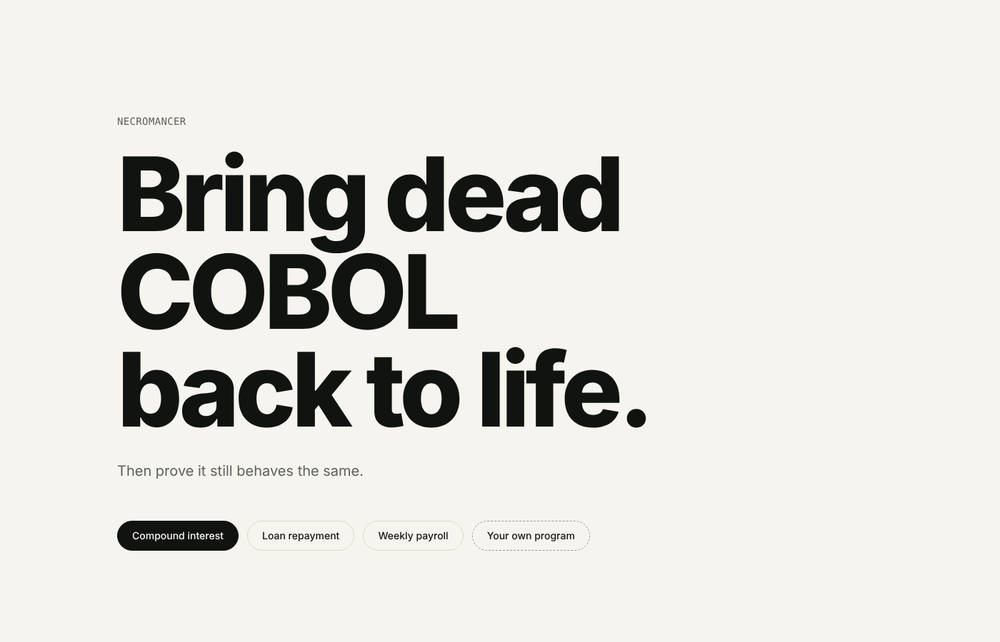
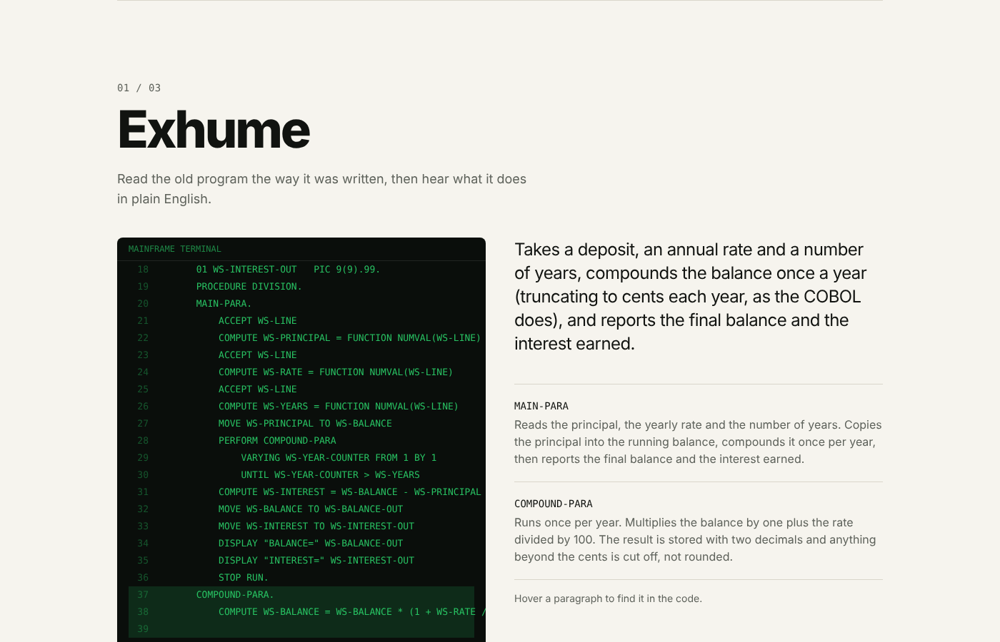
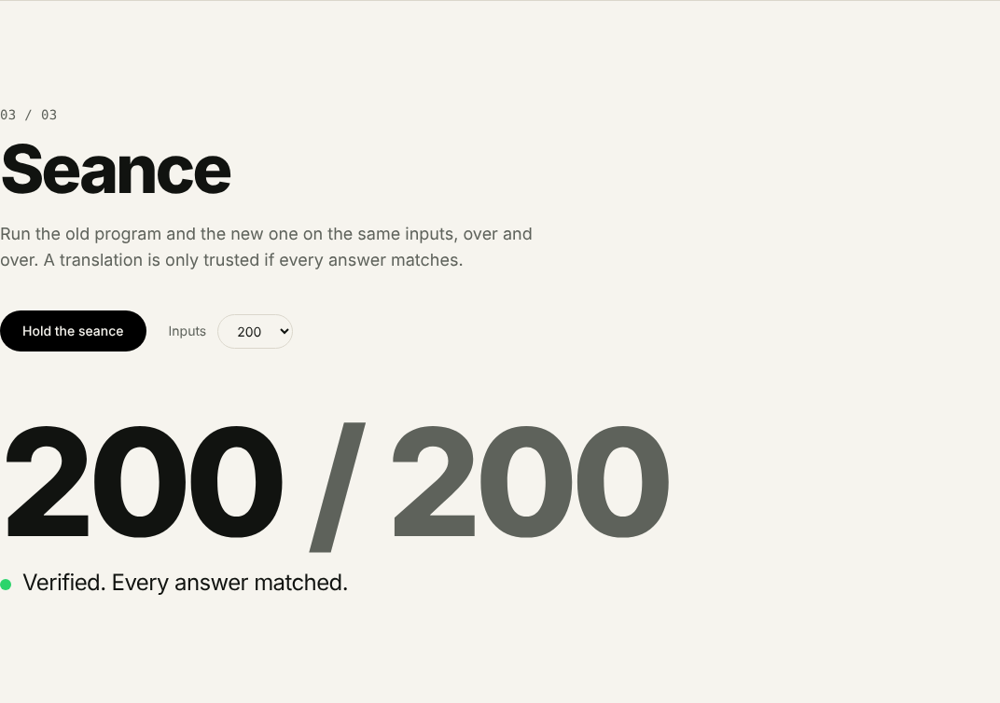
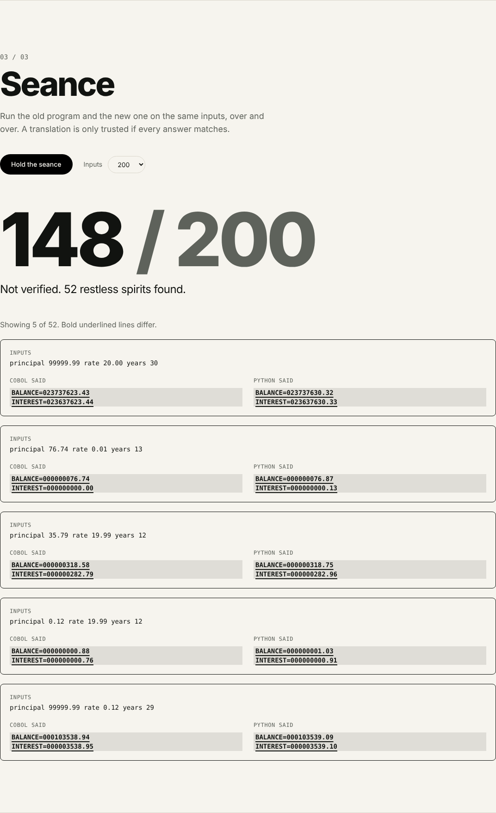
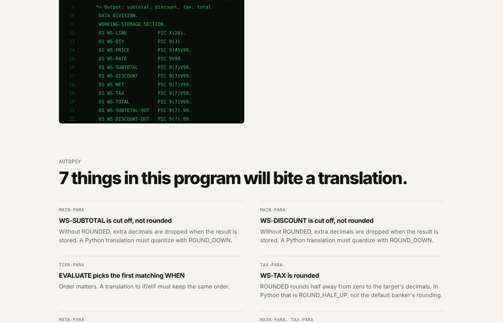
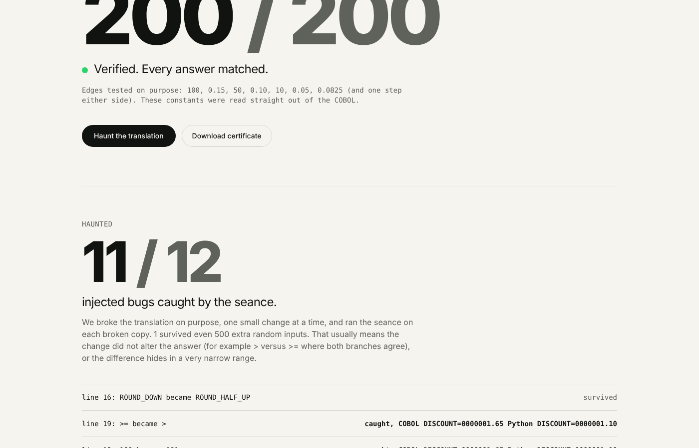
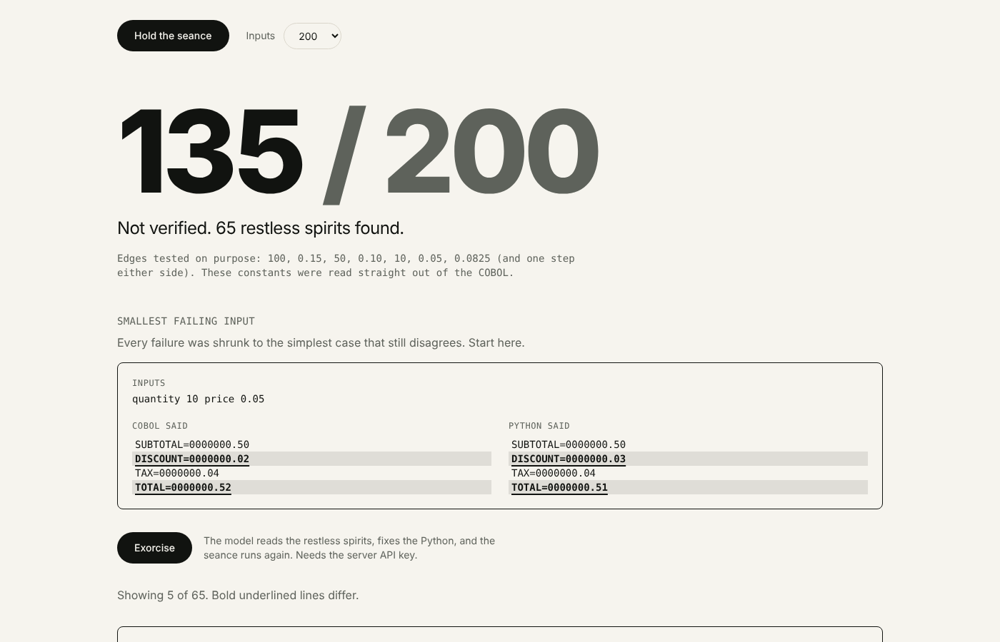

# Necromancer

**Bring dead COBOL back to life, and prove it still behaves the same.**

Banks, insurers and governments still run on COBOL, and the people who understand it are retiring. Necromancer takes a legacy COBOL program and walks it through three steps.

| Step | What happens |
|---|---|
| 01 / 03 **Exhume** | Reads the COBOL and explains what it does in plain English, paragraph by paragraph |
| 02 / 03 **Resurrect** | Translates it into clean, modern Python (Decimal for money, never float) |
| 03 / 03 **Seance** | Runs the original COBOL and the new Python on hundreds of generated inputs and checks that every output matches. Any mismatch shows up as a "restless spirit" you can inspect |

The seance is the point. A translation is never shown as correct unless it has been verified.

Built for **Kiroween 2026**, Resurrection category, with Kiro.

**Live demo:** https://necromancer-tau.vercel.app (the backend sleeps when idle, so the first request can take up to a minute).

## What it looks like









## What makes the proof strong

The seance is not a handful of hand picked examples. It is built to be hard to fool.

- **Boundary hunter.** Constants are read straight out of the COBOL (40 hours, 100 items, a 0.0825 tax rate) and every one is tested exactly and one step either side, because that is where translations break.
- **Smallest failing input.** Every failure is shrunk to the simplest case that still disagrees. A bad invoice port fails on one item costing 7 cents: COBOL charges 0.01 tax, the Python charges 0.00.
- **Haunt.** Necromancer injects bugs into the translation on its own (rounding mode swapped, `>` becomes `>=`, a rate nudged by one digit) and reports how many the seance catches. Survivors are shown, not hidden, with a second pass of 500 extra random inputs before one is called harmless.
- **Autopsy.** A static check lists what will bite a translation in this program: silent truncation, `ROUNDED`, silent overflow, unsigned fields, wrapping loop counters, `EVALUATE` order. No model needed.
- **Certificate.** A verified run can be downloaded as JSON: SHA 256 of both programs, the input ranges, the edges tested, the compiler version and the counts. It identifies exactly what was verified.
- **Exorcise.** When the seance fails, the model reads the restless spirits, repairs the Python, and the seance runs again, up to three rounds. This is the one feature that needs the API key. Its loop is tested with a mocked model and has not been run against a live model from this repo yet.

## Run it

You need Python 3.11+, Node 20+ and GnuCOBOL (`cobc`). The backend Docker image installs GnuCOBOL for you.

```bash
# backend
cd backend
pip install -r requirements.txt
python3 -m pytest -q
python3 -m uvicorn app.main:app --port 8000

# frontend (second terminal)
cd frontend
npm install
npm run dev
```

Open http://localhost:3000. The five bundled samples work without any API key, because their explanations and translations are bundled and the seance runs for real.

To use **Your own program**, paste COBOL that reads each input with `ACCEPT` into a text field followed by `FUNCTION NUMVAL`, click Find inputs, and adjust the ranges. Signed fields (`PIC S9...`) are detected too, with a range that includes negative numbers. You can write the Python yourself and run the seance with no key. To have Necromancer explain and translate it for you, set `ANTHROPIC_API_KEY` in the backend environment (see `.env.example`). The key is only ever used on the server.

Deploying: see [docs/DEPLOY.md](docs/DEPLOY.md). CI runs the tests and the frontend build on every push.

Docker, from the repo root:

```bash
docker build -f backend/Dockerfile -t necromancer-api .
docker run -p 8000:8000 necromancer-api
```

## Samples

| Sample | What it shows |
|---|---|
| `interest` | Compound interest, cents cut off every year |
| `payroll` | Overtime at 1.5x, tax on the part above 500.00 |
| `loan` | Month by month repayment loop with a 360 month cap |
| `invoice` | Discount tiers with EVALUATE, and tax with ROUNDED (rounds, where everything else truncates) |
| `balance` | Paid minus owed stored in an unsigned field, so a negative result silently loses its sign |

Each sample has a `.cbl` program, a `.json` file (summary, paragraph explanations, input ranges) and a `.py` translation. All five are verified by the seance in the test suite.

## What the seance caught

Four real COBOL traps showed up while building this, and the seance is what exposed them.

1. **COBOL truncates, Python rounds.** `COMPUTE` without `ROUNDED` cuts extra decimals off when it stores a result. A natural Python translation rounds instead, and the totals drift by cents. Translations must quantize with `ROUND_DOWN`. The reverse also holds: `COMPUTE ... ROUNDED` rounds half up, so the `invoice` sample needs `ROUND_HALF_UP` for its tax.
2. **`ACCEPT` into a numeric field copies characters.** `19.99` read into `PIC 9(2)V99` silently becomes `19.90`. Programs here read each line as text and convert it with `FUNCTION NUMVAL`.

3. **Unsigned fields drop the minus sign.** `COMPUTE` into an unsigned field stores the absolute value, so paid 0.00 minus owed 0.01 prints `0000.01`, while a natural Python translation prints `-000.01`. The `balance` sample is built around this, and the Autopsy warns about it before you run anything.
4. **Loop counters wrap.** A `PIC 9(2)` counter that must reach 99 wraps to 00, so the loop never ends. The seance reports a hang or crash in the old program as a restless spirit instead of stopping, and input ranges leave one digit of headroom.

## The I/O contract

- Input: one value per line on stdin, as plain decimal text such as `35.79`
- Output: lines on stdout from `DISPLAY`, exactly as the program prints them
- Python translations define `main(lines: list[str]) -> list[str]` with the same input and output
- Each sample declares safe input ranges, because COBOL silently overflows and a seance should test behaviour, not overflow luck

## API

| Endpoint | Purpose |
|---|---|
| `GET /api/health` | Liveness |
| `GET /api/samples`, `GET /api/samples/{id}` | Bundled programs |
| `POST /api/autopsy` | Static findings: what will bite a translation of this COBOL |
| `POST /api/haunt` | Inject bugs into the Python and report how many the seance catches |
| `POST /api/exorcise` | Model repairs a failing translation, seance re-runs (needs API key) |
| `POST /api/infer-inputs` | Detect a program's inputs (ACCEPT plus NUMVAL) and safe default ranges |
| `POST /api/exhume` | Plain English explanation (bundled sample or custom COBOL via the model) |
| `POST /api/resurrect` | Python translation (bundled sample or custom COBOL via the model) |
| `POST /api/seance` | Run COBOL and Python on generated inputs, return matches and restless spirits |

## Stack

- Frontend: Next.js 14 (App Router), TypeScript, Tailwind CSS
- Backend: Python, FastAPI
- COBOL runtime: GnuCOBOL (`cobc`)
- Equivalence checking: property based testing with Hypothesis
- LLM calls happen on the backend only, never in the browser

## How Kiro is used

- **Steering** in [`.kiro/steering`](.kiro/steering) holds the product, tech and design rules that every change follows
- **Agent hook** in [`.kiro/hooks`](.kiro/hooks) runs the test suite whenever backend code or a COBOL sample changes
- **Specs** drive the build from requirements to design to tasks

## Ground rules

- Sample COBOL programs stay small (under 200 lines) and live in `/samples`
- Every backend endpoint has a test
- No API keys in code, only environment variables and a `.env.example`
- Simple, readable code over clever code

## Design

Off-white background, near-black text, one accent colour (phosphor green, `#2BD46B`) used sparingly. The only dark element is the green-screen terminal panel that shows the old COBOL. Calm, slow transitions, and spooky only through restraint.

## License

[MIT](LICENSE)
